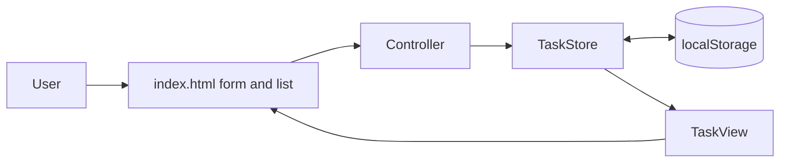

# KAN-116 Architecture

## Status
| Field | Value |
|-------|-------|
| Story | KAN-116 - Create Basic To-Do List |
| Stage | 02 Architecture |
| Pre-step hook | ready (story dir and pipeline-state.json exist; stage 01 approved 2026-10-21) |
| Input | `docs/KAN-116/01-requirements.md` |
| Status | approved |

## Repository Context
- No application code, `package.json`, or web assets exist; the repo holds only SDLC agent definitions (hooks, instructions, prompts, skills) and `docs/`. This is a greenfield app (Q4 answered by inspection, not by the user).
- No runtime or tooling constraints exist (Q5 unanswered).

## Design Decisions
| ID | Decision | Rationale | Depends on |
|----|----------|-----------|-----------|
| AD-1 | Static front-end web app: `index.html`, `styles.css`, `app.js` (vanilla JS, ES modules not required); no backend, no build step. | Simplest design meeting FR-1..FR-7; no stack constraint given. | **A1**, Q5 (assumption) |
| AD-2 | New tasks are inserted at the top of the list. | Newest-first gives immediate visibility; resolves Q1 provisionally. | **Q1 (assumption)** |
| AD-3 | Persist tasks in `localStorage` under one key (`todo.tasks`) as a JSON array; load on start, save after each mutation. Storage failures are caught and the app continues in memory. | Low-cost; avoids data loss on reload. | **A2**, Q2 (assumption) |
| AD-4 | Delete is immediate with no confirmation. | AC-2 states permanent removal and mentions no confirmation. | **Q3 (assumption)** |
| AD-5 | Empty/whitespace-only input is rejected (trimmed; no task added, input kept, focus retained). Max length 200 chars. | Prevents empty tasks. Length limit is a defensive addition. | **A3** |
| AD-6 | Completed tasks stay visible with a distinct style (strikethrough, reduced contrast) and can be toggled back via a checkbox. | Satisfies FR-7. | **A4** |
| AD-7 | Rendering uses DOM APIs (`textContent`, `createElement`), never `innerHTML` with user data. | OWASP A03 (XSS). | none |
| AD-8 | Task IDs are generated with `crypto.randomUUID()` (fallback: timestamp + counter). | Stable keys for delete/toggle. | none |
| AD-9 | Supported browsers: current evergreen browsers. | No constraint given. | **Q5 (assumption)** |

## Components
| Component | Responsibility |
|-----------|----------------|
| `index.html` | Page shell: heading, form (label, text input, "Add Task" button), `<ul>` task list, empty-state message, live region. |
| `styles.css` | Layout, completed-task style, visible focus states, contrast. |
| `TaskStore` (in `app.js`) | In-memory array of tasks; `add`, `toggle`, `remove`, `all`; load/save via `localStorage`. No DOM access. |
| `TaskView` (in `app.js`) | Renders list from store state; builds item DOM (checkbox, text, delete button). |
| `Controller` (in `app.js`) | Wires form submit (button and Enter), list event delegation (toggle/delete), input clearing, validation. |

## Data Model
```
Task { id: string, text: string, completed: boolean, createdAt: number }
Storage: localStorage["todo.tasks"] = JSON array of Task (newest first)
```

## Interfaces
- `TaskStore.add(text) -> Task | null` (null when invalid)
- `TaskStore.toggle(id) -> void`
- `TaskStore.remove(id) -> void`
- `TaskStore.all() -> Task[]`
- DOM events: form `submit` (covers button and Enter); delegated `click`/`change` on the list.



## Traceability
| Requirement | Component / Decision |
|-------------|----------------------|
| FR-1 | `index.html` form, Controller submit handler, AD-5 |
| FR-2 | `TaskStore.add`, TaskView render, AD-2 |
| FR-3 | Controller clears input after successful add |
| FR-4 | Delete button in TaskView, Controller delegation, `TaskStore.remove` |
| FR-5 | `TaskStore.remove` + re-render + save (AD-3, AD-4) |
| FR-6 | TaskView renders `TaskStore.all()`; empty-state message |
| FR-7 | `TaskStore.toggle`, AD-6 |
| AC-1 | FR-1..FR-3 mapping above |
| AC-2 | FR-4, FR-5 mapping above |

No unmapped requirements.

## Security (OWASP Top 10)
- A03 Injection/XSS: AD-7; no `innerHTML`, `eval`, or inline handlers; add a restrictive CSP meta tag (`default-src 'self'`).
- Input validation: trim, non-empty, 200-char cap (AD-5).
- A02/A09: no secrets, credentials, or network calls; do not store sensitive data (document that localStorage is unencrypted).
- A08 Integrity: validate parsed `localStorage` JSON (array of well-formed tasks), discard invalid data.
- No third-party dependencies, which avoids A06 supply-chain exposure.

## Accessibility
- Visible `<label>` for the input; buttons have accessible names (e.g. "Delete task: <text>") even when shown as a trash icon.
- Native `<form>`, `<button>`, `<input type="checkbox">`, so keyboard and Enter work by default.
- Visible focus; WCAG AA contrast; completed state not conveyed by color alone (strikethrough); `aria-live="polite"` region announces add/delete/complete.

## Testability
- `TaskStore` is DOM-free and unit-testable (add/trim/reject, toggle, remove, persistence round-trip, corrupt storage).
- Controller/View behavior verified with DOM-level tests (add via click and Enter, input cleared, delete removes item, toggle).
- Test framework is not chosen here; defer to the implementation planner (no existing tooling).

## Integrations
None. (Jira and GitHub are used only by the pipeline, not the app.)

## Risks
| Risk | Mitigation |
|------|------------|
| Q1 answered differently (bottom order) | Order is isolated in `TaskStore.add`; single-line change. |
| Q2 says persistence not wanted | Persistence isolated behind load/save; can be removed. |
| Q3 requires confirmation | Add confirm step in Controller only; store unchanged. |
| Q4/Q5 reveal an existing codebase or stack (e.g. React) | AD-1 and AD-9 would be revisited; component responsibilities carry over. |
| FR-7 has no Jira acceptance criterion | Behavior defined by A4/AD-6; confirm criteria at review. |
| localStorage unavailable (private mode, quota) | Try/catch; fall back to in-memory with no crash. |

## Open Items Requiring Approval
- Confirm provisional choices: AD-2 (top, Q1), AD-3 (persist, Q2/A2), AD-4 (no confirmation, Q3), AD-1/AD-9 (vanilla JS, evergreen browsers, Q5).
- Confirm assumptions A1-A4 (AD-1, AD-3, AD-5, AD-6).
- Added beyond the requirements: 200-char limit and CSP (security hardening); reject if unwanted.

## Approval
| Field | Value |
|-------|-------|
| Decision | approved |
| Approver | vasu_sachdeva (session user; name not stated in reply) |
| Rationale | User replied "approved"; provisional choices AD-1 to AD-4, AD-9, assumptions A1-A4, and the added 200-char limit and CSP are accepted |
| Evidence | This artifact; `01-requirements.md` (approved 2026-10-21); user reply |
| Timestamp | 2026-10-21 |
| Next agent | `03-design-review.agent.md` after `approved` |
