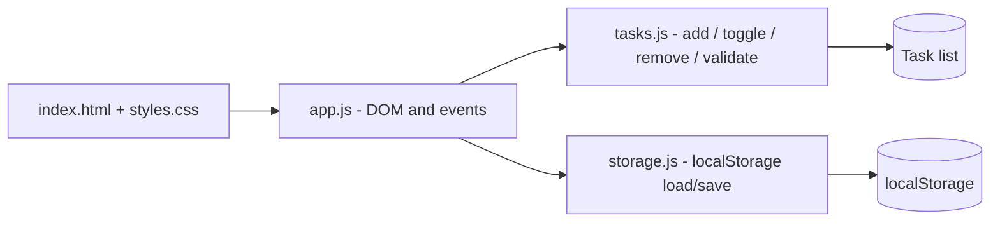

# KAN-116 - Architecture: Create Basic To-Do List

- **Story ID:** KAN-116
- **Input artifact:** docs/KAN-116/01-requirements.md (approved by vasu_sachdeva, 2026-10-16)
- **Output artifact:** docs/KAN-116/02-architecture.md
- **Repository context:** Workspace contains only pipeline docs, agents, hooks, skills and a validation script; no application code exists. Node.js is available locally.

## Architecture Decisions

| ID | Decision | Rationale | Resolves |
|----|----------|-----------|----------|
| AD-1 | Static, single-page web app: `app/index.html`, `app/styles.css`, `app/app.js`. No framework, no build step. | Story is a small foundational UI; stage 05 must run locally without a GitHub repo. | Open Q1 |
| AD-2 | Persist tasks in browser `localStorage` under one key. | Keeps tasks across reloads with no backend. "Permanently removed" means removed from the stored list. | Open Q2, A-3 |
| AD-3 | Separate pure task logic (`tasks.js`, no DOM access) from DOM rendering (`app.js`). | Lets logic be unit-tested with Node's built-in test runner. | Testability |
| AD-4 | New tasks are appended at the bottom of the list. | Story allows top or bottom; bottom matches reading order. | A-2 |
| AD-5 | Completed tasks are toggleable (checkbox) and shown with strikethrough. | Satisfies FR-6 and makes status visible. | Open Q3 |
| AD-6 | Delete is immediate with no confirmation. | AC-2 specifies direct removal. | Open Q4 |
| AD-7 | Trim input; reject empty text; cap length at 200 characters. | Prevents blank tasks; limit is an assumption pending approval. | A-1, Open Q5 |
| AD-8 | Render task text with `textContent` only, never `innerHTML`. | Prevents XSS from user-entered text (OWASP A03). | Security |

## Components



| Component | Responsibility |
|-----------|----------------|
| `tasks.js` | Pure functions: `addTask(list, text)`, `toggleTask(list, id)`, `removeTask(list, id)`; returns new arrays; validates text. |
| `storage.js` | `loadTasks()` and `saveTasks(list)`; tolerates missing or corrupt data by returning `[]`. |
| `app.js` | Wires form submit (button click or Enter), renders list, handles toggle and delete clicks, clears input after add. |
| `index.html` / `styles.css` | Form with input and "Add Task" button; `<ul>` task list; per-task checkbox and trash-icon delete button with accessible labels. |

## Data Model

```
Task { id: string, text: string, completed: boolean, createdAt: number }
```

Stored as a JSON array in `localStorage["kan116.tasks"]`.

## Interfaces

- `addTask(tasks, text) -> Task[]`: throws or returns unchanged list on empty or over-length text; new task has `completed=false`.
- `toggleTask(tasks, id) -> Task[]`
- `removeTask(tasks, id) -> Task[]`
- `loadTasks() -> Task[]`, `saveTasks(tasks) -> void`

## Requirement Traceability

| Requirement | Component / Decision |
|-------------|----------------------|
| FR-1 | `index.html` form |
| FR-2, FR-3 | `addTask`, `app.js` render (AD-4) |
| FR-4 | `app.js` clears input after successful add |
| FR-5 | `removeTask`, delete button (AD-6) |
| FR-6 | `toggleTask` (AD-5) |
| FR-7 | `app.js` render of full list |

## Integrations

- None. No backend, network, or third-party services. Jira and GitHub MCP are pipeline-only and not used by the application.

## Security and Quality

- Output encoding via `textContent` (AD-8); no `eval`, no inline event handlers.
- No secrets or personal data; storage is local to the browser.
- Keyboard accessible: form submit on Enter, buttons focusable, `aria-label` on icon-only buttons.

## Risks

| Risk | Impact | Mitigation |
|------|--------|------------|
| Assumptions AD-1 to AD-7 differ from stakeholder intent | Rework in stage 05 | Confirm at design review (stage 03) |
| `localStorage` unavailable or full | Tasks not persisted | `storage.js` fails safe; app still works in memory |
| No formal AC for completion | Ambiguous acceptance | Treated as FR-6 and covered by a test |

## Approval

- **Decision:** approved
- **Approver:** vasu_sachdeva (user)
- **Rationale:** User explicitly replied "approved for stage 2".
- **Evidence:** this document; predecessor approval in 01-requirements.md
- **Timestamp:** 2026-10-16
- **Next agent on approval:** `03-design-review.agent.md`
