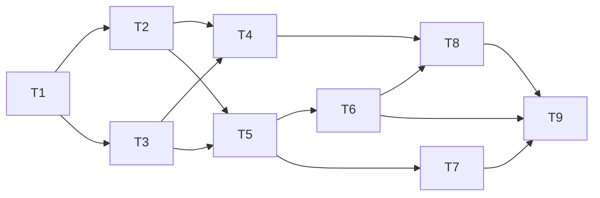

# KAN-116 - Implementation Plan: Create Basic To-Do List

- **Story ID:** KAN-116
- **Input artifact:** docs/KAN-116/03-design-review.md (approved by vasu_sachdeva, 2026-10-16)
- **Output artifact:** docs/KAN-116/04-impl-plan.md
- **Scope:** Local static web app and tests only. No GitHub interaction before stage 08.

## File Layout

```
app/
  index.html      form, list, CSP meta, classic script tags
  styles.css
  tasks.js        pure logic (dual export)
  storage.js      localStorage load/save (dual export)
  app.js          DOM wiring
tests/
  tasks.test.js   node --test
package.json      "test": "node --test tests/"
```

## Ordered Tasks

| # | Task | Depends on | Covers | Design findings |
|---|------|-----------|--------|-----------------|
| T1 | Create `package.json` with `"test": "node --test tests/"`; no dependencies. | - | - | DR-9 |
| T2 | Implement `app/tasks.js`: `MAX_LENGTH = 200`, `addTask`, `toggleTask`, `removeTask`. Return new arrays; invalid or empty text returns the list unchanged; ids from `Date.now()` plus random suffix; dual export (`globalThis.Tasks` and `module.exports`). | T1 | FR-2, FR-3, FR-5, FR-6 | DR-1, DR-2, DR-3, DR-6 |
| T3 | Implement `app/storage.js`: `loadTasks` validates shape and returns `[]` on missing, corrupt or throwing storage; `saveTasks` swallows storage errors; key `kan116.tasks`; dual export. | T1 | FR-7 | DR-1, DR-8 |
| T4 | Write `tests/tasks.test.js`: add (active status, appended at bottom, trimmed), empty/whitespace rejected, over-length rejected, toggle both ways, remove, immutability, storage fallback with a fake storage, id uniqueness. | T2, T3 | AC-1, AC-2, AC-3 | DR-9 |
| T5 | Implement `app/index.html`: CSP meta `default-src 'none'; script-src 'self'; style-src 'self'`; form with labelled input (`maxlength=200`) and "Add Task" button; `<ul id="task-list">`; classic `<script>` tags in order `tasks.js`, `storage.js`, `app.js`. | T2, T3 | FR-1 | DR-1, DR-6, security |
| T6 | Implement `app/app.js`: load on start; form `submit` handles click and Enter; on valid add, save, render, clear input; on invalid keep focus on input; checkbox toggles; trash button deletes; render with `textContent` and `createElement` only; delete button `aria-label="Delete task: <text>"` with inline SVG icon. | T5 | FR-1 to FR-7 | DR-7, AD-8 |
| T7 | Implement `app/styles.css`: clean layout, strikethrough and muted color for completed tasks, visible focus states. | T5 | UI quality | - |
| T8 | Add XSS test: task text `` is stored and returned as plain text; render uses `textContent` (verified by code review of `app.js`). | T4, T6 | Security | Security review |
| T9 | Run `npm test`; open `app/index.html` via `file://` and check each acceptance criterion in a browser. Record commands and results in `05-implementation-summary.md`. | T1-T8 | AC-1 to AC-3 | DR-4 |



## Validation Strategy

| Level | Method | Evidence |
|-------|--------|----------|
| Unit | `node --test tests/` | Test output recorded in stage 05 summary |
| Acceptance | Manual walk-through in a browser from `file://`: add via button, add via Enter, input clears, new task is active, toggle, delete | Checklist in stage 05 summary |
| Security | XSS test plus review of `textContent` use and CSP | Stage 06 review |
| Pipeline | `tests/validate-story.ps1 -JiraId KAN-116` | Stage 07 |

## Artifacts To Produce in Later Stages

| Stage | Artifact | Note |
|-------|----------|------|
| 05 | `05-implementation-summary.md` | Name required by `validate-story.ps1` (DR-4) |
| 06 | `06-code-review.md` | State key `code-review` with `approval: approved` (DR-5) |
| 07 | `07-verification.md` | Includes validation script result |

## Risks

| Risk | Mitigation |
|------|-----------|
| Cannot run a browser from the agent environment | Use Node tests for logic; list manual browser checks as steps for the user and record what was and was not executed |
| `validate-story.ps1` expects `code-review` state key | Plan follows DR-5 |
| Assumptions (AD-1 to AD-7) | Already approved; no change in this plan |

## Out of Scope

- Backend, accounts, sync, filtering, editing task text, drag and drop.
- Fixing the README filename mismatch (DR-4 follow-up).

## Approval

- **Decision:** approved
- **Approver:** vasu_sachdeva (user)
- **Rationale:** User explicitly replied "approved for stage 4".
- **Evidence:** this document; predecessor approval in 03-design-review.md
- **Timestamp:** 2026-10-16
- **Next agent on approval:** `05-implementation.agent.md`
