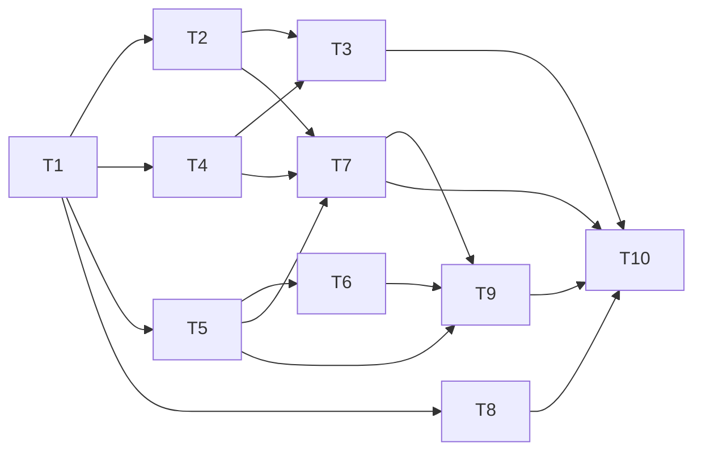

# KAN-116 Implementation Plan

## Status
| Field | Value |
|-------|-------|
| Story | KAN-116 - Create Basic To-Do List |
| Stage | 04 Implementation Planning |
| Pre-step hook | ready (story dir and `pipeline-state.json` exist; stage 03 `approved` 2026-10-21; stage matches sequence) |
| Input | `03-design-review.md` (approved), `02-architecture.md` (approved), `01-requirements.md` (approved) |
| Status | approved |
| Scope | Local only. Stages 01-07 must not require GitHub. |

## Decisions
| ID | Decision | Source |
|----|----------|--------|
| PD-1 | Layout is the `app/` folder from README (DR-1); the architecture's root-level layout is superseded; architecture file is not edited. | DR-1 |
| PD-2 | DR-3 option (a): classic `<script>` files, no build, works over `file://`. `tasks.js` and `storage.js` use a UMD-style wrapper (attach to `window.TodoApp`, and `module.exports` when `module` exists) so `node --test` can `require` them. | DR-3 |
| PD-3 | `package.json` with no dependencies; `npm test` runs `node --test tests/`. | DR-2 |
| PD-4 | `tests/validate-story.ps1 -JiraId <KEY>` is in scope. | DR-2 |
| PD-5 | CSP meta: `default-src 'none'; script-src 'self'; style-src 'self'; img-src 'self' data:`. No inline scripts or styles, no inline handlers. | DR-4 |
| PD-6 | FR-7 derived criteria D-1..D-4 (tagged derived from A4, not Jira) defined below. | DR-5 |
| PD-7 | Input has `maxlength="200"`; rejected input shows an inline message and is announced in the `aria-live` region; `TaskStore.add` still enforces the limit. | DR-6 |
| PD-8 | After delete, focus moves to the next item's delete button, else the previous, else the input. | DR-7 |
| PD-9 | Storage validator: string `id`, non-empty string `text` at most 200 chars, boolean `completed`, numeric `createdAt`; invalid items and duplicate IDs dropped; whole value dropped if not an array. Fallback ID counter is seeded from loaded data so IDs stay unique after reload. | DR-8 |
| PD-10 | ID generation feature-detects `crypto.randomUUID`; fallback path is unit-tested. | DR-9 |
| PD-11 | Multi-tab is a known limitation (last write wins); recorded in the implementation summary, no `storage` listener. | DR-10 |
| PD-12 | `createdAt` is kept (supports ordering and debugging). | DR-11 |
| PD-13 | Carried from stage 02: new tasks at top (AD-2), persistence via `localStorage` key `todo.tasks` (AD-3), no delete confirmation (AD-4), 200-char cap (AD-5). | AD-2..AD-5 |

## File Layout
```
app/
  index.html     Shell, CSP meta, form, <ul>, empty-state, live region, script tags (tasks, storage, app)
  styles.css     Layout, completed style, focus, contrast
  tasks.js       TaskStore (DOM-free): add, toggle, remove, all; ID generation; validator
  storage.js     load/save over an injected storage object; try/catch fallback to memory
  app.js         TaskView + Controller (DOM wiring, messages, focus)
tests/
  tasks.test.js       Unit tests (node --test)
  validate-story.ps1  Pipeline validation script
package.json          npm test, no dependencies
```
Script load order in `index.html`: `tasks.js`, `storage.js`, `app.js`.

## Tasks
| ID | Task | Depends on | Covers | Resolves | Verification |
|----|------|-----------|--------|----------|--------------|
| T1 | Create `package.json` (name, version, `"test": "node --test tests/"`, no dependencies). | none | pipeline | DR-2 | `npm test` runs (may report zero tests until T3) |
| T2 | Create `app/tasks.js`: `TaskStore` with `add(text)` (trim, reject empty/over-200, insert at top, uuid with fallback), `toggle(id)`, `remove(id)`, `all()`; UMD-style export; storage validator; counter seeding. | T1 | FR-1, FR-2, FR-4, FR-5, FR-6, FR-7 | DR-3, DR-8, DR-9, DR-11 | Unit tests in T3 |
| T3 | Create `tests/tasks.test.js` for `TaskStore` and `storage.js` (cases in Test Plan). Written alongside T2/T4. | T2, T4 | FR-1..FR-7, AC-1, AC-2 | DR-2, DR-5, DR-8, DR-9 | `npm test` passes |
| T4 | Create `app/storage.js`: load/save with `todo.tasks` key, injected storage object, try/catch fallback to memory, validation on load. | T1 | FR-2, FR-6 | DR-3, DR-8 | Unit tests in T3 |
| T5 | Create `app/index.html`: label, input (`maxlength="200"`), "Add Task" button, `<ul>`, empty-state, inline message element, `aria-live="polite"` region, CSP meta (PD-5), external scripts only. | T1 | FR-1, FR-6 | DR-4, DR-6 | Manual `file://` load; grep for inline script/style/handlers |
| T6 | Create `app/styles.css`: layout, completed style (strikethrough plus reduced contrast), visible focus, AA contrast. | T5 | FR-7 | DR-4 | Manual visual and contrast check |
| T7 | Create `app/app.js`: TaskView (DOM APIs only, `textContent`, checkbox, text, delete button with accessible name "Delete task: <text>") and Controller (submit via button and Enter, input clear on success, validation message plus live region, delegated toggle/delete, focus handling). | T2, T4, T5 | FR-1..FR-7, AC-1, AC-2 | DR-6, DR-7, DR-10 | Manual acceptance (below); grep for `innerHTML`/`eval` |
| T8 | Create `tests/validate-story.ps1 -JiraId <KEY>`: checks `docs/<KEY>/01..06` filenames exist, `pipeline-state.json` is present, and the `code-review` state is approved; non-zero exit on failure; parameterized, no hardcoded story. | T1 | pipeline | DR-2 | Run against KAN-116 after stage 06 approval; unit check with a missing-file case |
| T9 | Security and consistency pass: confirm no `innerHTML`, `eval`, inline handlers, network calls, or dependencies; confirm CSP loads from `file://`. | T5, T6, T7 | NFR/security | DR-4 | Checklist in Test Plan |
| T10 | Write `docs/KAN-116/05-implementation-summary.md` with commands, output, results, skipped checks, and the DR-10 multi-tab limitation, plus deviations from architecture (layout, PD-1). | T3, T7, T8, T9 | all | DR-1, DR-10 | Artifact present with approval block `pending` |

No cycles: T1 is the root; T2 and T4 depend only on T1; T3 depends on T2/T4; T5 on T1; T6 on T5; T7 on T2/T4/T5; T8 on T1; T9 on T5-T7; T10 last.



Recommended order: T1, T2, T4, T3, T5, T6, T7, T8, T9, T10.

## Derived FR-7 Criteria (from assumption A4, not Jira)
| ID | Criterion |
|----|-----------|
| D-1 | Given an active task, when the user ticks its checkbox, then the task is marked completed and shown with a non-color cue (strikethrough). |
| D-2 | Given a completed task, when the user unticks the checkbox, then it returns to active style. |
| D-3 | Given a toggled task, when the page reloads, then the state is preserved. |
| D-4 | A completed task remains in the list and can still be deleted. |

## Test Plan
### Unit (`node --test`, `tests/tasks.test.js`)
- add: valid text creates active task at index 0; trims; rejects empty and whitespace; rejects over 200; accepts exactly 200; returns null on rejection.
- toggle on/off; toggle unknown id is a no-op.
- remove deletes only the target; unknown id is a no-op.
- all returns tasks in newest-first order.
- Persistence round-trip (fake storage object).
- Corrupt data: invalid JSON, non-array, items with wrong types, over-length text, duplicate IDs; valid items kept.
- Storage throwing on read or write: app continues in memory.
- ID fallback when `crypto.randomUUID` is missing; uniqueness after reload with seeded counter.

### Acceptance (manual, open `app/index.html` over `file://` in an evergreen browser)
| ID | Check | Covers |
|----|-------|--------|
| AT-1 | Type text, click "Add Task": task appears at top as active; input clears. | AC-1, FR-1..FR-3 |
| AT-2 | Same with Enter key. | AC-1, FR-1 |
| AT-3 | Click trash/Delete: task removed from list; remains gone after reload. | AC-2, FR-4, FR-5 |
| AT-4 | With tasks, all are listed; with none, empty-state message shows. | FR-6 |
| AT-5 | D-1..D-4. | FR-7 |
| AT-6 | Empty/whitespace input: inline message visible, announced via live region, input kept and focused. 200+ chars cannot be typed or pasted beyond the limit. | DR-6 |
| AT-7 | After deleting, focus lands per PD-8. | DR-7 |
| AT-8 | Page loads fully from `file://` with CSP active (no console CSP errors). | DR-4 |
| AT-9 | Keyboard-only use works; labels and accessible names present. | Accessibility |

### Security
- Grep `app/` for `innerHTML`, `outerHTML`, `eval`, `new Function`, `on\w+=`, `<script>` without `src`, `<style>`, `fetch`, `XMLHttpRequest`: expect none.
- Task text containing `` renders as literal text.
- `package.json` has no dependencies.

### Pipeline
- `./tests/validate-story.ps1 -JiraId KAN-116` runs after stage 06 approval; stage 05 records it as not yet runnable if prerequisites are absent, and never reports a pass for a script or file that does not exist.

## Requirement Traceability
| Requirement | Tasks | Tests |
|-------------|-------|-------|
| FR-1 | T2, T5, T7 | Unit add; AT-1, AT-2 |
| FR-2 | T2, T4, T7 | Unit add/all; AT-1 |
| FR-3 | T7 | AT-1, AT-2 |
| FR-4 | T2, T7 | Unit remove; AT-3 |
| FR-5 | T2, T4, T7 | Unit remove and persistence; AT-3 |
| FR-6 | T2, T5, T7 | Unit all; AT-4 |
| FR-7 | T2, T6, T7 | Unit toggle; AT-5 (D-1..D-4) |
| AC-1 | T2, T5, T7 | AT-1, AT-2 |
| AC-2 | T2, T7 | AT-3 |

## Design Finding Coverage
| Finding | Task(s) |
|---------|---------|
| DR-1 | PD-1, T10 |
| DR-2 | T1, T3, T8 |
| DR-3 | PD-2, T2, T4 |
| DR-4 | PD-5, T5, T9 |
| DR-5 | PD-6, T3, T7 (AT-5) |
| DR-6 | PD-7, T5, T7 |
| DR-7 | PD-8, T7 |
| DR-8 | PD-9, T2, T4, T3 |
| DR-9 | PD-10, T2, T3 |
| DR-10 | PD-11, T10 |
| DR-11 | PD-12, T2 |

All findings have a task; every task traces to a requirement or finding.

## Artifacts Later Stages Must Produce
| Stage | File |
|-------|------|
| 05 | `app/index.html`, `app/styles.css`, `app/tasks.js`, `app/storage.js`, `app/app.js`, `tests/tasks.test.js`, `tests/validate-story.ps1`, `package.json`, `docs/KAN-116/05-implementation-summary.md` |
| 06 | `docs/KAN-116/06-code-review.md` |
| 07 | `docs/KAN-116/07-verification-report.md` |
| 08 | `docs/KAN-116/08-pr-summary.md` and the pull request (the only stage needing GitHub) |

## Risks
| Risk | Impact | Mitigation |
|------|--------|-----------|
| UMD wrapper diverges between browser and Node | Tests pass but browser fails | AT-8 manual `file://` check; wrapper kept minimal |
| CSP blocks local assets on `file://` | App appears broken | PD-5 directives; AT-8 |
| DOM behavior (Controller/View) has no automated tests (no DOM library, no dependencies) | Regressions in UI wiring | Keep logic in `TaskStore`; manual AT-1..AT-9 recorded in stage 05; revisit if a DOM test tool is approved |
| `validate-story.ps1` depends on stage 06 output | Cannot pass at stage 05 | Record as not yet runnable; run at stage 07 |
| FR-7 criteria are derived, not Jira | Disputed expectations | Tagged as derived (D-1..D-4); confirm at approval |
| Provisional Q1-Q5 answers differ | Rework | Order, persistence, confirmation isolated in single places |
| Multi-tab last write wins | Lost edits across tabs | Documented limitation (PD-11) |

## Out of Scope
- Backend, authentication, build tooling, third-party dependencies.
- Editing task text, reordering, filtering, due dates.
- Multi-tab synchronization.
- Automated DOM/browser tests.
- Editing `02-architecture.md` or `README.md` (layout already matches README).
- GitHub interaction before stage 08.

## Open Items Requiring Approval
- Confirm DR-3 option (a) UMD-style `tasks.js`/`storage.js` split (PD-2) and the `app/` layout (PD-1).
- Confirm derived FR-7 criteria D-1..D-4.
- Confirm that DOM behavior is verified manually, not by automated tests.
- Confirm `validate-story.ps1` check scope (files 01-06 exist plus `code-review` approved) per README.
- Confirm DR-10 (known limitation) and DR-11 (keep `createdAt`).

## Approval
| Field | Value |
|-------|-------|
| Decision | approved |
| Approver | vasu_sachdeva (session user; name not stated in reply) |
| Rationale | User replied "approved for stage 4"; plan, derived FR-7 criteria D-1 to D-4, manual DOM verification, validate-story.ps1 scope, DR-10 and DR-11 accepted |
| Evidence | This artifact; `03-design-review.md`, `02-architecture.md`, `01-requirements.md` (all approved 2026-10-21); user reply |
| Timestamp | 2026-10-21 |
| Next agent | `05-implementation.agent.md` after `approved` |
